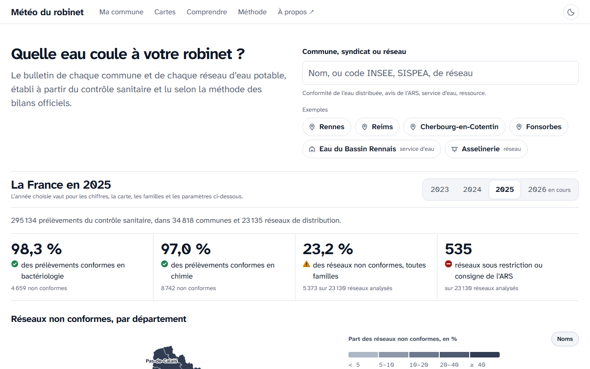

# Météo du robinet

Les données publiques de l'eau potable en France, de la ressource au robinet :
**[meteodurobinet.fr](https://meteodurobinet.fr)**

Pour chaque commune et chaque réseau de distribution, la plateforme rassemble :

- la qualité de l'eau distribuée, **réseau par réseau**, avec une note de A à D calculée selon l'indicateur
  annuel des agences régionales de santé ;
- les avis sanitaires des agences régionales de santé : restrictions de consommation, consignes d'ébullition,
  recommandations aux publics sensibles ;
- les services d'eau et le prix de l'eau (observatoire SISPEA) ;
- la ressource : prélèvements, nappes, restrictions sécheresse du jour.

L'unité de mesure est le réseau de distribution, celui qu'analyse le contrôle sanitaire : la plateforme ne compte
pas des communes « concernées » et n'estime aucune population.

Ce dépôt sert le site en ligne : la branche `gh-pages` contient le site construit. Le code source n'est pas
publié.

## Sources

Données publiques, réutilisées pour l'essentiel sous la Licence Ouverte 2.0 d'Etalab ; chaque source et son
producteur sont cités sur la page [Comprendre](https://meteodurobinet.fr/methode/) du site.

| Source | Producteur | Contenu |
|---|---|---|
| Contrôle sanitaire de l'eau distribuée (SISE-Eaux) | Ministère chargé de la Santé, ARS | chaque analyse et la conclusion de chaque prélèvement |
| SISPEA | Office français de la biodiversité | prix, rendement, renouvellement, mode de gestion des services |
| BNPE | Office français de la biodiversité | volumes prélevés pour l'eau potable, par ouvrage |
| BNV-D | Office français de la biodiversité | ventes de produits phytopharmaceutiques par département |
| ADES, piézométrie | BRGM | qualité et niveau des eaux souterraines (Hub'Eau) |
| Naïades | Agences de l'eau | qualité des cours d'eau (Hub'Eau) |
| VigiEau | Ministère de la Transition écologique | restrictions sécheresse en vigueur, interrogées en direct |
| Contours administratifs | Etalab, IGN | départements et communes |

## Auteur et licences

Réalisé par Aurélien Nogent, consultant en eau potable : [hydroforge.fr](https://hydroforge.fr)
(formulaire de contact).

- **Code** : © 2026 Aurélien Nogent, tous droits réservés (fichier `LICENSE`). Toute demande :
  [hydroforge.fr/contact](https://hydroforge.fr/contact/).
- **Contenus publiés sur meteodurobinet.fr** (textes, notes calculées, cartes, tableaux) : licence
  [CC BY-NC 4.0](https://creativecommons.org/licenses/by-nc/4.0/deed.fr). Toute réutilisation cite « Météo du
  robinet (meteodurobinet.fr), conçue par Hydroforge (hydroforge.fr), d’après le contrôle sanitaire des eaux du
  ministère chargé de la Santé », avec le lien de la page, et reste non commerciale.
- **Données sources** : sous la licence de leurs producteurs, pour l'essentiel la Licence Ouverte 2.0 d'Etalab.
- **Polices** Atkinson Hyperlegible : SIL Open Font License.
